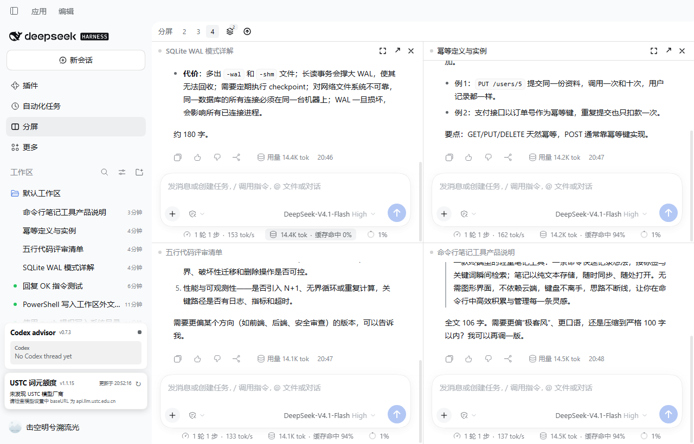

# dsh-multiview — split view for DeepSeek Harness

2-4 real Chats you rearrange entirely from the keyboard, save as named layouts, and jump through by which pane needs you.

> Two to four **real** conversations side by side in one window. Every pane is the shipped Chat: composer, streaming, tool cards, approval cards, `ask_user_question`, attachments, slash commands, stop/queue.
>
> The goal is not "a working split view" — it is to read as a feature the app ships with: no title-bar takeover, no layout hijacking, no monkey-patching of private extension points.

[中文](README.zh.md) | English



## Install

Install from npm with `dsh plugin add dsh-multiview`, or search for it under **Plugins → Add** in DSH Desktop (a maintainer can also run `plugin_manager install_bundle`), then **quit and reopen** DeepSeek Harness so the client bundle loads again.

A "Split" icon appears in the left panel list; click it to turn the central column into the stage, click again to return to the native conversation.

- Requires DSH `>=0.2.1-rc.5 <0.2.2-0 || >=0.2.2-rc.1 <0.2.3-0 || >=0.2.3-rc.1 <0.3.0-0` (`engines.dsh`). Each prerelease line is listed explicitly, because node-semver does not let a prerelease match a range that never names its version.
- Uninstall: disable/remove on the Plugins page, restart. Two `localStorage` keys stay behind:
  `dsh.multiview.v1` (the saved layout and splits) and `dsh.multiview.update.v1` (the last
  update-check result, so the button does not re-check on every reload). The stage's "Reset"
  clears the layout key; remove them both if you want a clean slate.

## Using it

| Action | How |
|---|---|
| Open / close | The "Split" icon in the sidebar panel list |
| 2 / 3 / 4 panes | The `2` `3` `4` chips in the stage bar |
| Resize | Drag the divider between panes |
| Swap two panes | Drag a pane **title** onto another pane, or `Mod+Alt+S` to swap with the next one |
| Maximize / restore | The ⤢ button in the pane header; the stage bar shows "Restore" |
| Bind an empty pane | Search and pick a session right inside the pane |
| Put any session into the split | Hover a **session row** in the sidebar → the split button; or the row's `…` menu → "Open in split view". Nothing leaves the split: an empty pane is filled, a new pane is added under the four-pane cap, and only a full split replaces the focused pane |
| Notice from anywhere | The sidebar Split icon carries a dot when any pane is waiting for an answer or finished unread, so you do not have to be looking at the split to know something wants you |
| Jump to what needs you | The pane header's status dot is a button (a pane that is waiting for an answer or finished unread); `Mod+Alt+J` cycles to the next such pane |
| Open in the native view | The ↗ button: hands the session back to the real conversation (the right sidebar's file preview and diff review only exist there) |
| Remove a pane | The ✕ button; a bound pane goes **back to the session list** (the split keeps its shape), an empty pane is what ✕ actually removes |
| Views | Bar → Views: a split with 2+ sessions is remembered automatically; click to restore, ✎ to rename it (a name you type survives later layout edits), ✕ to delete. While you are on a saved split, further edits (moving, swapping, adding panes) update **that** entry instead of piling up near-duplicates |
| Check for updates | Refresh icon at the right of the bar: checked every 24h, red dot on a new release, confirm to update |

Shortcuts (module defaults; rebind in **Settings → Shortcuts**):

| Command | Default (desktop) |
|---|---|
| Focus previous / next pane | `Mod+Alt+[` / `Mod+Alt+]` |
| Jump to the pane that needs you | `Mod+Alt+J` |
| Swap places with the next pane | `Mod+Alt+S` |
| Maximize or restore the focused pane | `Mod+Alt+M` |
| Remove the focused pane from the split | `Mod+Alt+W` |

The divider itself is a focusable separator: `←`/`→` (or `↑`/`↓` on a stacked split) move it by 2 %,
`Shift` takes 5 % steps, and `Home` / `Enter` / `Space` restore an even split.

> The browser (Web) shell gets **no default bindings**: DSH's shortcut layer accepts a very narrow set of web/Linux combinations, and forcing one fails at boot with "reserved". Desktop defaults work; bind them manually on Web.

### Corners worth knowing

- **Two panes is the floor.** An empty pane cannot be removed from a two-pane split (its ✕ is hidden), because every preset, the `2` `3` `4` chips and the saved-split key assume at least two.
- **Archiving leaves the split.** Archive a conversation anywhere and its pane empties at once; the pane stays where it was.
- **Shrinking keeps what you are watching.** Going from four panes to two drops two conversations, and the focused one always survives — it takes the first seat.
- **Maximize needs a conversation.** An empty pane offers no ⤢: enlarging a picker would hide every other conversation.
- **Old splits heal.** Applying a saved split whose Sessions were deleted or archived restores the shape and empties only those panes; the saved entry is kept (never silently deleted) and rewritten to what could actually be restored.

See [docs/VERIFY-BY-HAND.md](docs/VERIFY-BY-HAND.md) for the checklist of behaviours that can only be confirmed in a real window.

Where the project stands — what changed since 0.1.28, what is verified and what is not: [docs/STATE-OF-PLAY.md](docs/STATE-OF-PLAY.md).

Who this is for, and the honest state of demand evidence: [docs/POSITIONING.md](docs/POSITIONING.md).

## Not supported in v1 (on purpose)

1. **File preview / diff inside a pane** — whenever any global panel is active, DSH unmounts the right sidebar's session surface (`no session surface is mounted`; shipped panels behave the same). Use ↗ to work in the native view.
2. **Creating a session inside a pane** — the hero's workspace picker is application-level navigation. Create sessions natively.
3. **Trajectory / plugin view switching per pane** — panes are pinned to Chat; no invented tabs.
4. **Sidebar click routed into the focused pane** — intercepting the row click means hijacking a private navigation path, so a plain click keeps its native behaviour (it leaves the split). The supported way to send a session to the split is the row's hover button or its `…` menu, which you choose to press.
5. Auto-sleep — resources are released when a pane is removed or rebound; there is no pretend "pause rendering of unfocused panes".
6. More than four panes.

## Performance

Measured with a CDP rAF sampler on `desktop-kfscv8c-1` (1530×851 window):

| Scenario | p50 | p95 | max | long tasks >50ms | JS heap |
|---|---|---|---|---|---|
| Native conversation (baseline) | 16.7ms | 16.7ms | 16.8ms | 0 | 43MB |
| Four panes mounted, idle | 16.7ms | 16.8ms | 16.8ms | 0 | 75MB |
| Four panes, two streams at once | 16.7ms | 16.7ms | 16.8ms | 0 | 85MB |
| Four panes, four long streams at once | 16.7ms | 50ms | 150ms | 2 | 53MB |

Four long streams is the heaviest case measured: still near 60fps on average, but p95 rises to 50ms with an occasional 150ms frame (four virtualized transcripts re-laying out per chunk). v1 deliberately does not throttle — "every pane stays a real Chat" wins over a frame number.

Long frames are not this plugin's work. A 3-minute run with two panes streaming into the VM build recorded 205 long tasks, so the CPU profiler was sampled during a live two-pane stream to attribute them (0.5ms sampling, 3609 samples):

| Owner | Share of sampled time |
|---|---|
| `dsh-multiview` | **0.0%** |
| Host / DSH UI packages | 7.1% |
| Idle, `(program)`, GC, native | 92.9% |

Over the same 3 minutes: 0 uncaught errors, JS heap 53MB → peak 85MB → 42MB (reclaimed, no unbounded growth), and both panes kept streaming to completion.

Transcripts are virtualized per turn by DSH itself, so a pane costs roughly one active turn plus one editor instance. Below 900px wide or 520px tall the stage degrades to a single pane plus a pane switcher (which shows each pane's status); the layout tree is preserved.

## Development

No third-party dependencies; Node ≥ 22.18 (this repo uses 24.13).

```powershell
npm run build     # src/client/*.ts → client.js (single-file bundle); src/host/index.ts → index.js
npm test          # layout algebra unit tests (node --test)
npm run check     # release self-check: manifest / artifacts / copy / size
```

Isolated verification (**writes no profile**):

```powershell
dsh --profile web --patch <repo>\.dev\dev.patch.yml --port 40602 --no-open
```

The overlay's row name is an absolute `file:///` URL to this repo's `index.js` (the Loader anchors relative row names at the profile root, not beside the patch file).

Rendering goes through public surfaces only: a keyed `main` panel, a session-scoped child slot,
`SessionProvider`, the `conversation.content` factory (`variant:'embedded'`), `sessions.retain`,
`shortcuts` and `locale`.

Two things fall outside that and are worth knowing before you install it: to open a file preview
from inside a pane it finds the host's own file chip by class name and click-dispatches it (the
right sidebar has no session surface while a main panel is active), and it reads one private store
field (`retainedBy.mainView`) to decide which session currently owns the native view. Both are
fallbacks with a documented reason, not the primary path. See [docs/DESIGN.md](docs/DESIGN.md).

## Status and support

Pre-1.0: the surface is stable enough to use daily, but small breaking changes can happen in a minor
bump, and every one of them is listed in [CHANGELOG.md](CHANGELOG.md). Versions are published from a
tag by CI with npm provenance, so what npm serves is exactly what this repository built.

The only network requests the client makes are the plugin market's same-origin API and, for version
discovery only, a public read of `registry.npmjs.org/dsh-multiview/latest` (no credentials, no
referrer). Installs still go through the market. `scripts/check.mjs` enforces that list.

`engines.dsh` accepts the `0.2` line from `0.2.1-rc.5` upward; `0.2.0` and 0.2.1 prereleases before
`rc.5` are excluded. Builds are verified against `0.2.1-rc.5` and `0.2.2-rc.1`, and the toolbar
tooltip stays silent across those two whole lines (patch-level differences are expected to keep the
API). On any other minor it appends 「DSH x.y.z 尚未验证」 instead of pretending the build was tested.

- Bugs and feature requests: [issues](https://github.com/Awenforever/dsh-multiview/issues) (templates ask for the two things that matter — plugin version and host version).
- Multi-pane rendering cost: filed upstream as [discussion #12559](https://github.com/deepseek-ai/deepseek-harness/discussions/12559).
- Theme-token gaps that cap overlay contrast (no light surface step, missing state-business-secondary): [discussion #12770](https://github.com/deepseek-ai/deepseek-harness/discussions/12770).
- Anything that is not split-view specific (sessions, permissions, providers) belongs to the harness project.

## License

MIT.
